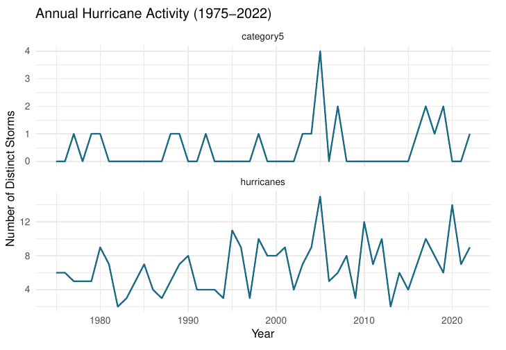
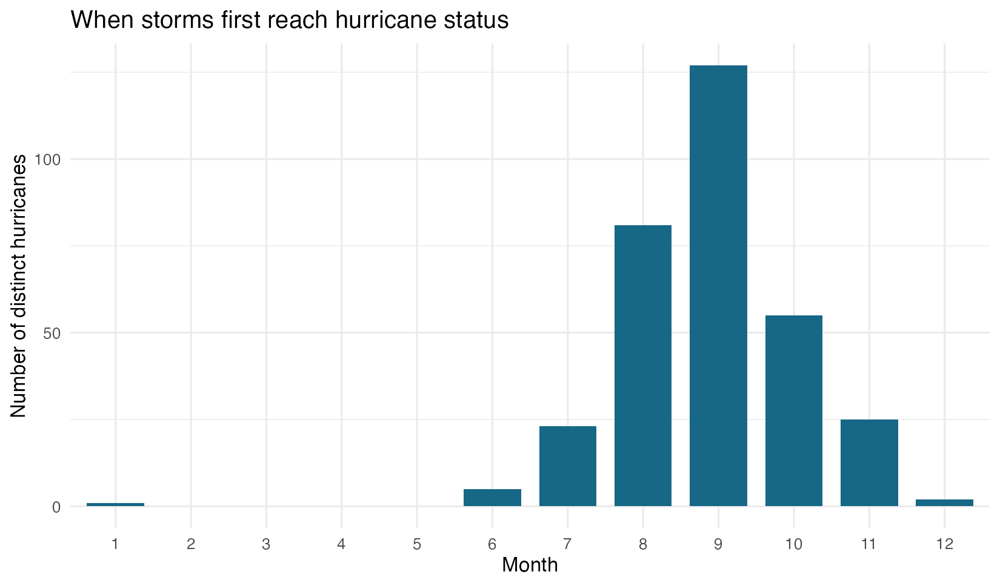
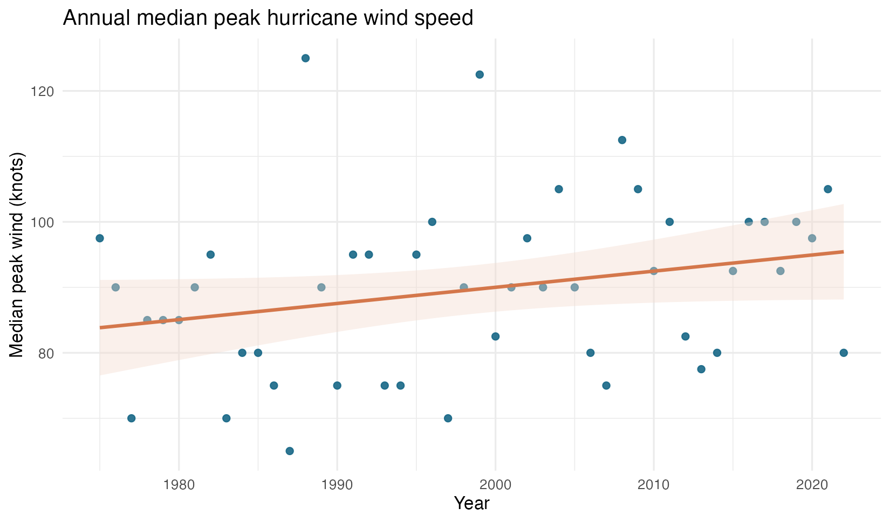
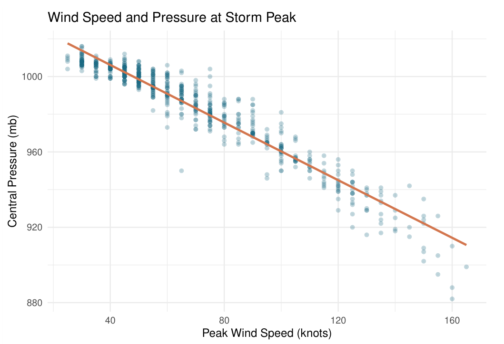
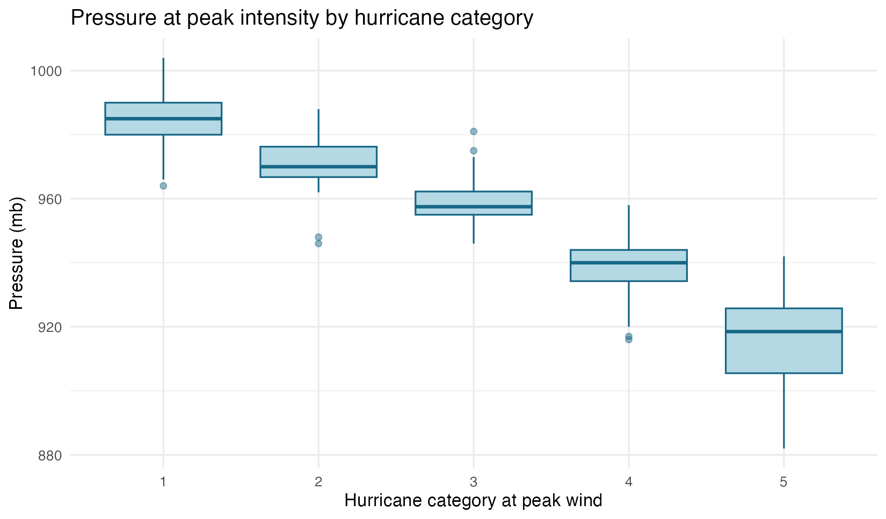
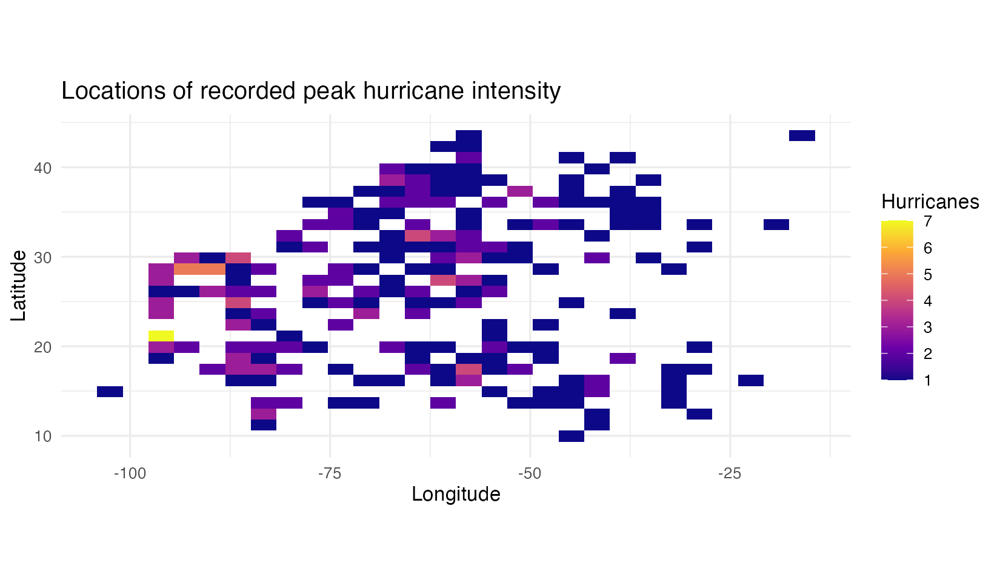

# Atlantic Hurricane Data Analysis in R

**Reproducible exploratory statistics and visualizations | 1975–2022 | Jeana Song**

An expanded, course-based R data analysis of historical Atlantic storm observations. The project combines missing-data auditing, custom aggregation functions, seasonal and annual analysis, correlation, linear regression, chi-squared testing, and spatial visualization.

> **Project context:** Adapted and extended from University of Michigan DATASCI 306 Homework 5. This is a programming and exploratory analysis sample, not a peer-reviewed climate attribution study.

## Main questions

1. How many distinct storms reach hurricane status annually, and how does the activity vary by month?
2. Has median peak hurricane wind speed changed across years in this dataset?
3. How do wind speed and pressure relate under Pearson correlation, Spearman correlation, and ordinary least squares?
4. How does pressure vary across hurricane categories, and where are storms at their recorded peak intensity?

## Selected visualizations

**1. Annual counts: distinct hurricanes vs Category 5 hurricanes**



**2. Seasonality: month when each storm first reaches hurricane status**



**3. Annual hurricane intensity: median peak wind (plus fitted linear trend)**



**4. Peak wind and central pressure**



**5. Pressure across Saffir-Simpson hurricane categories**



**6. Geographic distribution: locations of hurricane-stage peak wind**



## Methodology

| Stage | Method | Reason |
| --- | --- | --- |
| Import | `readr::read_csv()`; data checks | Local, reproducible CSV source |
| Audit | Missing values across fields | Avoid unnecessary or misleading imputation |
| Hurricane counts | `annual_hurricane_counts()` | Deduplicate frequent observations by `(year, name)` |
| Seasonal counts | First recorded *hurricane-status* month per distinct storm | Don't count the same storm repeatedly |
| Annual intensity | Maximum recorded hurricane-stage wind per storm; annual median | Compare years on a storm-level basis |
| Correlation | Pearson and Spearman | Compare linear and monotonic relationships |
| OLS | `lm(pressure ~ wind)` | Describe mean pressure change with recorded wind |
| Categorical test | `to_tercile()` + chi-squared | Illustrate dependence after binning variables |
| Maps and boxplots | `ggplot2` | Understand spatial and category-wise variation |

## Selected results (verified against the supplied CSV)

| Measure | Result |
| --- | ---: |
| Original observations / columns | 19,537 / 13 |
| Unique named storm-year groups | 655 |
| Unique named hurricanes | 319 |
| First observed at hurricane status during September | 127 of 319 (39.8%) |
| Pearson r: peak wind vs pressure (655 groups) | -0.9633 |
| Spearman rho: peak wind vs pressure (655 groups) | -0.9534 |
| OLS slope: pressure on peak wind | -0.7644 mb per knot |
| OLS R-squared | 0.9280 |
| Chi-squared test of quantile categories | χ²(4) = 694.09, p < 2.2×10⁻¹⁶ |
| Annual median peak wind trend (319 hurricanes grouped by year) | +0.247 knots/year, p ≈ 0.070 |

**Interpretation.** September is the most frequent month in which a storm first achieves hurricane status in these records. Wind and pressure show a strong negative, monotonic/near-linear association. The *annual median peak hurricane wind* trend is positive but **does not meet p < 0.05 under the fitted linear model**; this exploratory result does not establish long-run intensification or its causes.

## Repository contents

```text
Atlantic-Hurricane-Data-Analysis/
├── README.md
├── hurricane_analysis.R           # Full executable analysis
├── hurricane_analysis.Rmd         # Explanatory report; knit to HTML
├── Atlantic-Hurricane-Data-Analysis.Rproj
├── .gitignore
├── data/
│   └── storms.csv                 # Source data, 19,537 rows
└── figures/
    ├── annual_hurricane_counts.png
    ├── storm_peak_wind_pressure.png
    ├── hurricane_first_month.png
    ├── annual_peak_wind_trend.png
    ├── pressure_by_hurricane_category.png
    └── peak_hurricane_locations.png
```

## Run the project

1. Clone/download the repository, and open `Atlantic-Hurricane-Data-Analysis.Rproj` in RStudio.
2. Install required packages if necessary:

   ```r
   install.packages(c("readr", "dplyr", "tidyr", "ggplot2", "rmarkdown", "knitr"))
   ```
3. To run the full analysis and regenerate the `figures/` folder:

   ```r
   source("hurricane_analysis.R")
   ```
4. To knit the illustrated analysis report, open `hurricane_analysis.Rmd` and select **Knit**.

The pre-rendered figures in this repository show the same source data and calculations; the `.R` file regenerates charts with `ggplot2` in RStudio.

## Data provenance and important limitations

- Data snapshot: [`tidyverse/dplyr` v1.1.4 `storms.csv`](https://github.com/tidyverse/dplyr/blob/v1.1.4/data-raw/storms.csv), 1975–2022.
- Named storms are provisionally identified by `(year, name)` because this CSV does not include an unambiguous persistent storm ID.
- Counts are based on named hurricanes, not raw recorded measurements. Seasonality uses **first hurricane-stage month**, not formation date or landfall.
- Regression and correlation use peak wind records from 655 storm-year groups; results are **associations, not causal effects**.
- The category boxplot uses 319 hurricane-stage peak records. Hurricane category is defined using wind, so comparing wind across these categories would be circular; we instead compare **pressure**.
- Spatial maps locate peak recorded hurricane intensity and have no coastline layer; do not interpret them as genesis/landfall maps.
- This is observational data; the time span, reporting procedures, and potential changes in detection efficiency limit any interpretation of long-term climate trends.

## Author

Jeana Song | University of Michigan | Data Science
